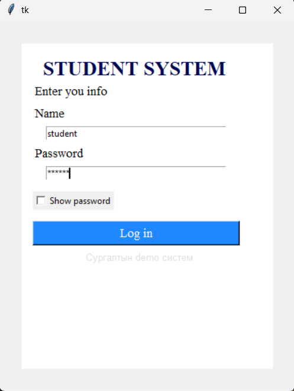
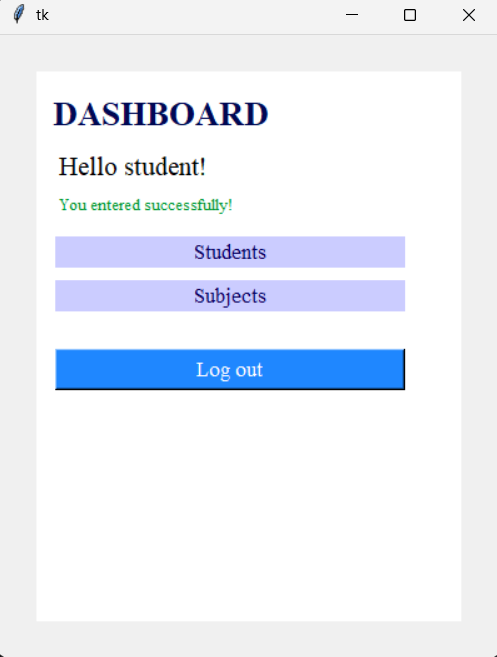

# 1. LAB5

**Оюутны нэр:**Б.Өнөболд
**Оюутны код:**V.IT23C100
**Огноо:**10/28/2026

# 2. Ажлын зорилго

Нэвтрэх оролтыг шалгаж, хэрэглэгчийн төлөв хадгалан, Logn болон Dashboard дэлгэцийн хооронд шилждэг программ бүтээх.

# 3. Боловсруулсан GUI-ийн sceenshot




# 4. Программын эх код

```python
import tkinter as tk

BG="white"
NAME = "student"
PASSWORD = f"123456"

def check():
    n = name_entry.get()
    p = password_entry.get()
    if n == NAME and p == PASSWORD:
        dashboard()
        return
    else:
        gg()
        sub_label = tk.Label(frame, text="Name or password is incorrect, try again!", font=("Times new roman", 13), anchor="e", fg="#000000", bg=BG)
        sub_label.grid(row=3, column=1, sticky="w", padx=(15, 0), pady=(5, 0))

        name_entry.config(bg="#ffd3d3")
        password_entry.config(bg="#ffd3d3")
        name_entry.focus_set()

def gg():
    name_entry.delete(0, tk.END)
    password_entry.delete(0, tk.END)


def dashboard():
    ss_f = tk.Frame(root)
    ss_f.config(bg=BG)
    ss_f.grid(row=1, column=1, columnspan=2, sticky="nsew", pady=30, padx=30)

    hlabel = tk.Label(ss_f, text="DASHBOARD", font=("Times new roman", 20, "bold"), fg="#000853", bg=BG)
    hlabel.grid(row=2, column=1, padx=(10, 0), pady=(15, 0), sticky="w")

    sub_label = tk.Label(ss_f, text="Hello student!", font=("Times new roman", 16), anchor="e", fg="#000000", bg=BG)
    sub_label.grid(row=3, column=1, sticky="w", padx=(15, 0), pady=(10, 0))

    name_label = tk.Label(ss_f, text="You entered successfully!", font=("Times new roman", 10), anchor="e", fg="#009933", bg=BG)
    name_label.grid(row=4, column=1, sticky="w", padx=(15, 0), pady=(5, 0))

    o_label = tk.Label(ss_f, text="Students", font=("Times new roman", 13), anchor="center", fg="#09005E", bg="#cbccff", width=28)
    o_label.grid(row=5, column=1, sticky="ew", padx=(15, 0), pady=(15, 5))

    s_label = tk.Label(ss_f, text="Subjects", font=("Times new roman", 13), anchor="center", fg="#09005E", bg="#cbccff", width=28)
    s_label.grid(row=6, column=1, sticky="ew", padx=(15, 0), pady=(5, 0))

    l_button = tk.Button(ss_f,
                   text="Log out",
                   bg="#1f87ff",
                   fg=BG,
                   width=30,
                   font=("Times new roman", 13),
                   command=show_d
                   )
    l_button.grid(row=9,
                  column=1, padx=(15, 0), pady=(30, 0))

def showy():
    if x.get() == 1:
        password_entry.config(show="")
        return
    else:
        password_entry.config(show="*")
        return

def show_d():
    frame.tkraise()
    gg()

root = tk.Tk()
root.geometry('400x500')

root.grid_rowconfigure(1, weight=1)
root.grid_columnconfigure(1, weight=1)
root.grid_columnconfigure(2, weight=1)

frame = tk.Frame(root)
frame.config(bg=BG)
frame.grid(row=1, column=1, columnspan=2, sticky="nsew", pady=30, padx=30)

label = tk.Label(frame, text="STUDENT SYSTEM", font=("Times new roman", 20, "bold"), fg="#000853", bg=BG)
label.grid(row=2, column=1, padx=(10, 0), pady=(15, 0))

sub_label = tk.Label(frame, text="Enter you info", font=("Times new roman", 13), anchor="e", fg="#000000", bg=BG)
sub_label.grid(row=3, column=1, sticky="w", padx=(15, 0))

name_label = tk.Label(frame, text="Name", font=("Times new roman", 13), anchor="e", fg="#000000", bg=BG)
name_label.grid(row=4, column=1, sticky="w", padx=(15, 0), pady=(5, 0))

name_entry = tk.Entry(frame, width=40)
name_entry.grid(row=5, column=1, padx=(15, 0), pady=(5, 0))

password_label = tk.Label(frame, text="Password", font=("Times new roman", 13), anchor="e", fg="#000000", bg=BG)
password_label.grid(row=6, column=1, sticky="w", padx=(15, 0), pady=(5, 0))

password_entry = tk.Entry(frame, width=40, show="*")
password_entry.grid(row=7, column=1, padx=(15, 0), pady=(5, 0))

x = tk.IntVar(value=0)

vision = tk.Checkbutton(frame,
                        text="Show password",
                        variable=x,
                        onvalue=1,
                        offvalue=0,
                        command=showy
                        )
vision.grid(row=8, column=1, padx=(15, 0),  pady=(15, 0), sticky="w")

button = tk.Button(frame,
                text="Log in",
                bg="#1f87ff",
                fg=BG,
                width=30,
                font=("Times new roman", 13),
                command=check).grid(row=9,
                column=1, padx=(15, 0), pady=(15, 0))

aside = tk.Label(frame, text="Сургалтын demo систем", bg=BG, fg="#dddddd", font=("Times, new roman", 10)).grid(row=10, column=1,  padx=(24, 0), pady=(5, 0))
root.mainloop()
```

# 5. Callback функцуудын тайлбар

**Callback** гэдэг нь өөр кодод дамжуулж өгөөд, тохирох үйл явдал болоход тэр код өөрөө дууддаг функц юм. Программ функцийг шууд дууддаггүй, зөвхөн "товч дарагдахад үүнийг дуудаарай" гэж бүртгэнэ. Дуудах ажлыг `root.mainloop()` хийнэ. Энэ нь үйл явдал хүлээж, ирэхэд бүртгэгдсэн callback-ийг ажиллуулдаг гогцоо юм.

## 5.1. Программд байгаа callback-ууд

| Callback | Бүртгэсэн газар                                              | Хэзээ дуудагдах                        |
| -------- | ------------------------------------------------------------ | -------------------------------------- |
| `check`  | `tk.Button(frame, text="Log in", command=check)`             | "Log in" товч дарахад                  |
| `showy`  | `tk.Checkbutton(frame, text="Show password", command=showy)` | "Show password" checkbox дарах бүрт    |
| `show_d` | `tk.Button(ss_f, text="Log out", command=show_d)`            | Dashboard дээрх "Log out" товч дарахад |

Гурван callback-ийг бүгдийг `command=` аргументаар бүртгэсэн. Функцийн нэрийг **хаалтгүй** бичсэн нь чухал. `command=check()` гэж бичвэл функц программ эхлэх үед шууд ажиллаж, товч дарахад юу ч болохгүй.

## 5.2. `check`

Хэрэглэгч "Log in" товчийг дарахад дуудагдана. Нэвтрэх оролтыг шалгана:

1. `name_entry.get()`, `password_entry.get()`-ээр оруулсан нэр, нууц үгийг авна.
2. Хоёулаа `NAME`, `PASSWORD` тогтмолтой таарвал `dashboard()`-ыг дуудаж Dashboard дэлгэц рүү шилжинэ.
3. Таарахгүй бол `gg()`-ээр талбаруудыг цэвэрлэж, "Name or password is incorrect" мессеж гаргаж, талбаруудыг улаавтар болгоод `name_entry`-д фокус өгнө.

## 5.3. `showy`

"Show password" checkbox дарах бүрт дуудагдана.

- Tkinter `x` хувьсагчийн утгыг **эхлээд** өөрчилж, дараа нь `showy`-г дууддаг. Тиймээс `x.get()` нь шинэ утгыг буцаана.
- `x.get() == 1` бол `show=""` болгож нууц үг харагдана.
- Үгүй бол `show="*"` болгож нууц үг нуугдана.

## 5.4. `show_d`

Dashboard дээрх "Log out" товч дарахад дуудагдана.

- `frame.tkraise()` нь нэвтрэх frame-ийг dashboard frame-ийн дээр гаргана. Хоёр frame нэг grid нүдэнд (row 1, column 1) давхцаж байгаа тул дээр нь гарсан нь л харагдана.
- `gg()` нь нэр, нууц үгийн талбарыг цэвэрлэнэ.

## 5.5. `global` яагаад хэрэггүй байсан бэ

`command=` нь callback-д аргумент өгдөггүй. Иймд callback-ууд `name_entry`, `password_entry`, `x`, `frame` зэрэг глобал widget-үүдийг шууд ашигладаг. Эдгээр нь зөвхөн **уншигдаж**, метод нь дуудагдаж байгаа бөгөөд хувьсагчид шинэ утга **оноогдохгүй** тул `global` зарлах шаардлагагүй.

## 5.6. Callback биш функцууд

| Функц             | Яагаад callback биш вэ                                           |
| ----------------- | ---------------------------------------------------------------- |
| `gg()`            | `check`, `show_d` дотроос шууд, хаалттай дуудагддаг туслах функц |
| `dashboard()`     | `check` дотроос шууд дуудагддаг                                  |
| `root.mainloop()` | Callback-уудыг дууддаг гогцоо өөрөө                              |

Callback нь зөвхөн `command=`-д **нэрээр нь**, дуудалгүйгээр дамжуулагдсан функц юм.

# 6. Дүгнэлт

Энэ лабораторийн ажлаар нэвтрэх оролтыг шалгаж, хэрэглэгчийн төлөв хадгалан, Login болон Dashboard дэлгэцийн хооронд шилждэг Tkinter программ бүтээлээ.

Программ нь `check`, `showy`, `show_d` гэсэн гурван callback функц дээр суурилсан. `check` нь оруулсан нэр, нууц үгийг тогтмол утгатай харьцуулж, зөв бол Dashboard руу шилжүүлж, буруу бол талбаруудыг цэвэрлэж алдааны мессеж харуулна. `showy` нь checkbox-ын төлвөөс хамааран нууц үгийг харуулж эсвэл нууна. `show_d` нь `tkraise()`-ээр Login frame-ийг дахин дээш гаргаж, талбаруудыг цэвэрлэнэ.

Callback-ийг `command=` аргументад функцийн нэрийг **хаалтгүй** дамжуулж бүртгэдэг, дуудах ажлыг `mainloop()` хийдэг гэдгийг ойлгосон. Мөн `command=` нь аргумент дамжуулдаггүй тул callback-ууд глобал widget-үүдийг шууд ашигладаг болохыг харсан.

Программд дараах дутагдал илэрсэн:

1. Алдааны мессеж болон талбаруудын улаавтар өнгө зөв нэвтэрсний дараа, logout хийсний дараа ч арилдаггүй. Алдаа гарах бүрт шинэ `Label` үүсч давхцдаг.
2. `button = tk.Button(...).grid(...)` хэлбэрээр бичсэн тул `button` нь `None` болдог.
3. Нэр, нууц үг кодод шууд бичигдсэн тул аюулгүй байдлын хувьд сул.

Цаашид алдааны мессежийг нэг `Label`-ээр хийж `config()`-оор шинэчлэх, `gg()` дотор өнгийг анхны төлөвт нь буцаах, `.grid()`-ийг тусад нь дуудах замаар программыг сайжруулж болно.
