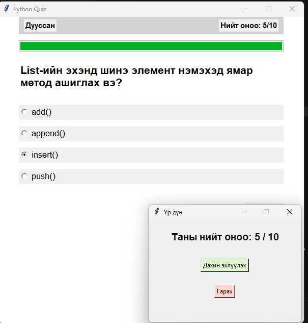

# 1. LAB 4
- **Оюутны нэр:** Б.Өнөболд
- **Оюутны код:** V.IT23C100
- **Огноо:** 10/22/2026

# 2. Ажлын зорилго
Олон сонголттой асуултын өгөгдлийг GUI-тай холбож, хэрэглэгчийн хариултыг шалган оноо тооцдог программ бүтээх

# 3. Боловсруулсан GUI-ийн screenshot


# 4. Программын эх код
```python
import tkinter as tk
from tkinter import ttk, messagebox
BG = "white"
current_question = 0
score = 0
selected_answer = 0
finished = False

def update_status():
    """Updates the question count, score counters, and progress bar dynamically."""
    if finished:
        question_number_label.config(text="Дууссан")
        score_label.config(text=f"Нийт оноо: {score}/{len(questions)}")
        progress["value"] = len(questions)
    else:
        question_number_label.config(text=f"Асуулт: {current_question + 1}/{len(questions)}")
        score_label.config(text=f"Оноо: {score}")
        progress["value"] = current_question

def show_questions():
    q_data = questions[current_question]
    selected_answer.set(None)
    
    question_label.config(text=q_data["question"])
    
    for button, option in zip(option_buttons, q_data["options"]):
        button.config(text=option, value=option, state="normal")
        
    last = (current_question == len(questions) - 1)
    
    btn_text = "Дуусгах" if last else "Дараах"
    next_button.config(text=btn_text, state="normal")
    update_status()

def next_question():
    global current_question, score, finished
    if finished:
        return
    answer = selected_answer.get()
    if answer == "":
        messagebox.showwarning(
            "Анхааруулга", "Хариугаа сонгоно уу.", parent = window
        )
        return
    if answer == questions[current_question]["answer"]:
        score += 1
    current_question += 1
    if current_question < len(questions):
        show_questions()
    else:
        finished =  True
        update_status()
        next_button.config(state="disabled")
        show_result_popup()

def show_result_popup():
    """Creates a custom modal window displaying final results with a restart option."""
    global result_window
    result_window = tk.Toplevel(window)
    result_window.title("Үр дүн")
    result_window.geometry("300x200")
    result_window.resizable(False, False)
    
    # Force focus onto the result pop-up window
    result_window.grab_set()
    
    tk.Label(
        result_window, 
        text=f"Таны нийт оноо: {score} / {len(questions)}", 
        font=("Arial", 14, "bold"), pady=20
    ).pack()
        
    tk.Button(
        result_window, 
        text="Дахин эхлүүлэх", 
        command=restart_quiz,
        bg="#E3F7D5",
        activebackground="#A9FD6D"
    ).pack(pady=10)

    tk.Button(
        result_window, 
        text="Гарах", 
        command=close_window,
        bg="#FFD6CE",
        activebackground="#FF846C"
    ).pack(pady=15)
    
def close_window():
    window.destroy()
    result_window.destroy()


def restart_quiz():
    global current_question, score, finished, result_window
    if result_window is not None:
        result_window.grab_release()
        result_window.destroy()
        result_window = None

    current_question = 0
    score = 0
    finished = False
    show_questions()
    window.focus_get()       

questions = [
    {
        "question": "List literal үүсгэх хаалт аль вэ?",
        "options": ["( )", "[ ]", "{ }", "< >"],
        "answer": "[ ]",
    },
    {
        "question": "Tuple үүсгэхэд ямар хаалт ашигладаг вэ?",
        "options": ["[ ]", "{ }", "( )", "< >"],
        "answer": "( )",
    },
    {
        "question": "Dictionary ямар хаалт ашигладаг вэ?",
        "options": ["( )", "[ ]", "{ }", "< >"],
        "answer": "{ }",
    },
    {
        "question": "Python дээр хувьсагчид утга оноох оператор аль вэ?",
        "options": ["==", "=", "!=", ">="],
        "answer": "=",
    },
    {
        "question": "Жагсаалтын хамгийн эхний элементийн индекс хэд вэ?",
        "options": ["0", "1", "-1", "2"],
        "answer": "0",
    },
    {
        "question": "Python дээр функц зарлах түлхүүр үг аль вэ?",
        "options": ["function", "define", "def", "func"],
        "answer": "def",
    },
    {
        "question": "Текстэн өгөгдлийн төрлийг аль нь илэрхийлэх вэ?",
        "options": ["int", "str", "float", "bool"],
        "answer": "str",
    },
    {
        "question": "Нөхцөл шалгахад ашигладаг түлхүүр үг аль вэ?",
        "options": ["for", "while", "if", "def"],
        "answer": "if",
    },
    {
        "question": "List-ийн төгсгөлд шинэ элемент нэмэхэд ямар метод ашиглах вэ?",
        "options": ["add()", "append()", "insert_end()", "push()"],
        "answer": "append()",
    },
    {
        "question": "List-ийн эхэнд шинэ элемент нэмэхэд ямар метод ашиглах вэ?",
        "options": ["add()", "append()", "insert()", "push()"],
        "answer": "insert()",
    },
]

window = tk.Tk()
window.title("Python Quiz")
window.geometry("600x600")
window.resizable(False, False)
window.configure(bg=BG)

status_frame = tk.Frame(window, bg="lightgray")

status_frame.pack(fill="x", padx=40)

question_number_label = tk.Label(status_frame, fg="black", font=("Arial", 11, "bold"))
question_number_label.pack(side="left", padx=10, pady=5)

score_label = tk.Label(status_frame, fg="black", font=("Arial", 11, "bold"))
score_label.pack(side="right", padx=10, pady=5)

progress = ttk.Progressbar(window, maximum=len(questions), mode="determinate")
progress.pack(fill="x", padx=40, pady=(12, 4))

question_label = tk.Label(
    window, text="", bg=BG, font=("Arial", 16, "bold"),
    wraplength=520, justify="left", anchor="w"
)
question_label.pack(fill="x", padx=40, pady=(18, 12))


selected_answer = tk.StringVar(master=window, value="")

options_frame = tk.Frame(window, bg=BG)
options_frame.pack(fill="x", padx=40, pady=10)

option_buttons = []
for _ in range(4):
    button = tk.Radiobutton(
        options_frame, variable=selected_answer, value="",
        anchor="w", font=("Arial", 13)
    )
    button.pack(fill="x", pady=6)
    option_buttons.append(button)

actions_frame = tk.Frame(window, bg=BG)
actions_frame.pack(fill="x", padx=40, pady=20)

next_button = ttk.Button(actions_frame, text="Дараах", command=next_question)
next_button.pack(side="right")


show_questions()

window.mainloop()
```

# 5. Callback функцуудын тайлбар

**Callback** гэдэг нь өөр кодод дамжуулж өгөөд, тохирох үйл явдал болоход тэр код өөрөө дууддаг функц юм. Программ функцийг шууд дууддаггүй, зөвхөн "товч дарагдахад үүнийг дуудаарай" гэж бүртгэнэ. Дуудах ажлыг `window.mainloop()` хийнэ. Энэ нь товч дарах зэрэг үйл явдлыг хүлээж, ирэхэд бүртгэгдсэн callback-ийг ажиллуулдаг гогцоо юм.

## 5.1. Программд байгаа callback-ууд

| # | Callback | Бүртгэсэн газар | Хэзээ дуудагдах |
|---|----------|-----------------|-----------------|
| 1 | `next_question` | `ttk.Button(..., command=next_question)` | "Дараах" / "Дуусгах" товч дарахад |
| 2 | `restart_quiz` | `tk.Button(..., command=restart_quiz)` | Үр дүнгийн цонхны "Дахин эхлүүлэх" товч дарахад |
| 3 | `close_window` | `tk.Button(..., command=close_window)` | Үр дүнгийн цонхны "Гарах" товч дарахад |

Гурван callback-ийн бүртгэл нь `command=` аргументаар хийгдсэн. Функцийн нэрийг **хаалтгүй** бичсэн нь чухал. `command=next_question()` гэж бичвэл функц программ эхлэх үед шууд ажиллаж, товч дарахад юу ч болохгүй.

## 5.2. `next_question`

```python
next_button = ttk.Button(actions_frame, text="Дараах", command=next_question)
```

Хэрэглэгч "Дараах" товчийг дарах бүрт дуудагдана. Асуултын гол логик энд байна:

1. Тест дууссан бол (`finished`) юу ч хийлгүй буцна.
2. `selected_answer.get()`-ээр сонгосон хариултыг авна. Хариулт сонгоогүй бол `messagebox.showwarning` харуулж, дараагийн асуулт руу шилжихгүй.
3. Сонгосон хариулт зөв хариулттай (`questions[current_question]["answer"]`) таарвал `score` нэмэгдэнэ.
4. `current_question` нэмэгдэнэ.
5. Асуулт үлдсэн бол `show_questions()`-ыг дуудна. Үлдээгүй бол `finished = True` болгож, "Дараах" товчийг идэвхгүй болгоод `show_result_popup()`-ыг дуудна.

Сүүлийн асуулт дээр товчны бичиг `show_questions` дотор "Дуусгах" болж өөрчлөгддөг боловч callback нь нэг л `next_question` хэвээр байна.

## 5.3. `restart_quiz`

```python
tk.Button(result_window, text="Дахин эхлүүлэх", command=restart_quiz, ...)
```

Үр дүнгийн цонхон дээрх "Дахин эхлүүлэх" товч дарахад дуудагдана.

- `result_window.grab_release()` нь цонхны фокус түгжээг тайлна.
- `result_window.destroy()` нь үр дүнгийн цонхыг хаана.
- `current_question`, `score`, `finished`-ийг анхны утгад нь буцаана.
- `show_questions()`-ыг дуудаж эхний асуултыг дахин харуулна. `show_questions` нь "Дараах" товчийг дахин `normal` төлөвт оруулдаг.

## 5.4. `close_window`

```python
tk.Button(result_window, text="Гарах", command=close_window, ...)
```

"Гарах" товч дарахад `window.destroy()`-ээр үндсэн цонхыг хааснаар `mainloop()` дуусаж, программ зогсоно.

## 5.5. Callback-д аргумент дамжихгүй тул глобал хувьсагч ашигласан

`command=` нь callback-д ямар ч аргумент өгдөггүй. Иймд `next_question`, `restart_quiz` нь хэрэгтэй өгөгдлөө (`current_question`, `score`, `finished`) **глобал хувьсагчаас** авдаг. Утгыг өөрчлөхийн тулд функц дотор `global` гэж зарласан:

```python
def next_question():
    global current_question, score, finished
```

`global` зарлаагүй бол `score += 1` нь шинэ local хувьсагч үүсгэх гэж оролдож, `UnboundLocalError` өгнө.

## 5.6. Callback биш функцууд

| Функц | Яагаад callback биш вэ |
|-------|------------------------|
| `update_status()` | `next_question`, `show_questions` дотороос шууд дуудагддаг туслах функц |
| `show_questions()` | `next_question`, `restart_quiz`, программ эхлэхэд шууд дуудагддаг |
| `show_result_popup()` | `next_question` дотороос шууд дуудагддаг |
| `window.mainloop()` | Callback-уудыг дууддаг гогцоо өөрөө |

Эдгээр функц `()`-тэй, шууд дуудагддаг. Callback нь зөвхөн `command=`-д **нэрээр нь**, дуудалгүйгээр дамжуулагдсан функц юм.

# 6.  Илэрсэн алдаа ба шийдэл 
Анх 
```python
    selected_answer.set("")
```
ингэж бичихэд доор бас 
```python 
button = tk.Radiobutton(options_frame, variable=selected_answer, value="")
```
ингэж бичсэн болохоор дэлгэцэн дээр бүгдээрэй сонгогдсон гарж ирээд байсан. Мөн None утга өгж үзсэн ч гэсэн "Дараах" товчин дээх дарахад warning цонх гарч ирэхгүй шууд дараагийн асуултыг гарч ирсэн учир нь шалгаж байгаа нөхцөл нь тийм биш байсан болохоор. 
Мөн сүүлийн цонхын "гарах" товчийг дарахаар яаж цонхыг байхгүй болгохын тулд дахиж function зарлаж өгсөн.

# Дүгнэлт

Олон сонголттой асуултын өгөгдлийг GUI-тай холбож, хэрэглэгчийн хариултыг шалган оноо тооцдог программ бүтээлээ. 
## Сурсан зүйлс

- **grab_set()**: Нээгдсэн шинэ цонхыг (жишээ нь: Үр дүнгийн цонх) үндсэн цонхны дээр       "түгжиж" өгнө. Хэрэглэгч энэ цонхыг хаах эсвэл дахин эхлүүлэх хүртэл ард байгаа үндсэн цонхны товчлуурууд дээр дарах боломжгүй (Frozen) болдог.
- **grab_release()**: Цонхны түгжээг буцааж тавин, үндсэн цонхыг чөлөөтэй удирдаж, товших боломжтой болгоно.
- **state="readonly"** (Унадаг цонхонд): Хэрэглэгч тухайн Combobox дотор гараас текст бичиж оруулахыг хориглож, зөвхөн бидний бэлдсэн сонголтуудаас "сонгож унших" төлөвт оруулна.
- **state="normal"**: Товчлуур эсвэл текстийг энгийн, хэрэглэгч дарах болон өөрчлөх боломжтой идэвхтэй төлөвт оруулна.
- **state="disabled"**: Товчлуурыг идэвхгүй (саарал өнгөтэй) болгож, дарах боломжгүй болгоно. (Жишээ нь: Асуулт дуусахад "Дараах" товчийг идэвхгүй болгох).
- **anchor ба justify**: Текстийг хайрцаг дотроо аль зүг рүү наалдаж харагдах (anchor="w" буюу Баруун урагш/Зүүн тал руу), олон мөр текст дундаа хаашаа зэрэгцэж харагдахыг (justify="left") тохируулж сурсан.
- ProgressBar: bar харуулагч

